# ES DSL Studio

> Elasticsearch 可视化查询编辑器 —— 不用背 DSL，拖出来就是查询 JSON。

ES 的查询 DSL 本质上是一棵树：组合查询是内部节点，词项/全文查询是叶子节点。ES DSL Studio 把这棵树直接画出来——从左侧元素库拖拽查询节点到画布、嵌套组合，右侧实时生成语法高亮的 DSL JSON，所见即所得。

自带一个索引管理视图：像 MyCat 那样按「数据源 → 索引 → 字段」浏览多个 ES 集群的索引结构，并一键把字段同步到查询编辑器。生成的 DSL 也能直接对 ES 执行，结果以表格 / 聚合 / 原始 JSON 就地展示。

前端纯 HTML / CSS / 原生 JS，**零依赖、零构建**。后端有两种形态，任选其一：

- **Tauri 桌面应用**（推荐）：Rust 单文件服务逻辑编译进 exe，不依赖 Python，数据源凭据存在本机 `%APPDATA%`
- **Python 3 标准库单文件服务**（`server.py`）：同样零依赖，适合局域网共享

双击 `web/index.html` 也能用（浏览器直连模式）。

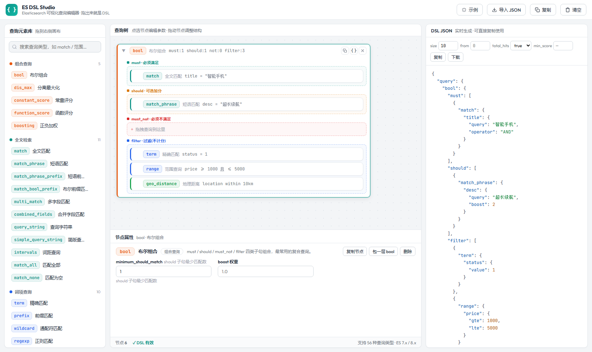

## 功能特性

### 拖拽式查询树编辑

- 左侧元素库收录 **56 种查询类型**，按 10 个分类着色分组，支持关键词搜索
- 拖拽或点 `+` 添加节点；组合查询（bool 等）带彩色槽位，拖入即建立嵌套关系
- 已有节点可拖动调整层级与顺序、复制、删除、一键「包一层 bool」
- 往已有根查询上再拖一个查询，自动用 bool 组合
- 点选节点后，在树下方属性面板中表单化编辑参数（带必填校验）
- 每个填选控件（输入框 / 下拉 / 文本域）**有值时右侧浮出 `✕`**，一点即清空并同步 DSL；下拉清空后回到「（默认）」，不会把一个空参数发给 ES

### 实时 DSL 生成

- 右侧 JSON 面板实时输出完整 search body，语法高亮
- 支持 size / from / track_total_hits / min_score 查询设置
- 一键复制到剪贴板、下载 `.json` 文件
- 底部状态栏实时提示必填缺失与 JSON 格式错误

### 直接执行并查看结果

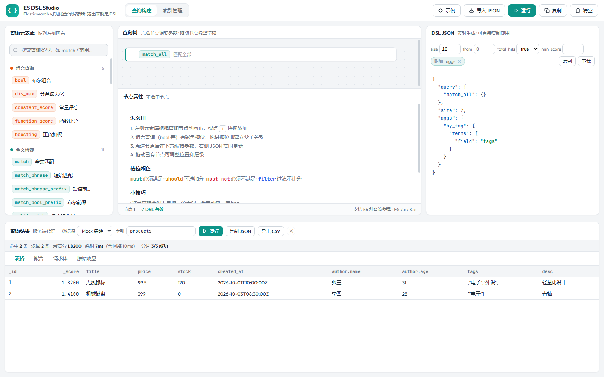

顶栏左侧（紧跟「查询构建 / 索引管理」切换器）就是运行目标，选好数据源和索引后点右侧「运行」即可（图中属性面板的 `字段名` 旁即为一键清空按钮）：

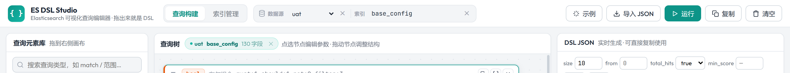

右侧生成的 DSL 不用复制走人——点顶栏 **▶ 运行**（或 `Ctrl+Enter`），直接用当前 DSL 查所选数据源的索引，结果落在底部抽屉里。

查询目标（**数据源 + 索引**）就在顶栏左侧、紧跟视图切换器：数据源是下拉直选，索引是「可输可选」组合框——点输入框或右侧 `▾` 弹出自绘索引列表（每条带集群健康状态点、文档数与存储容量，支持输入过滤、键盘 ↑↓/Enter 选中），列表加载期间输入框内有小转圈提示；两者右侧都有 `✕` 一键清空。切到索引管理视图时这组控件会自动隐藏。

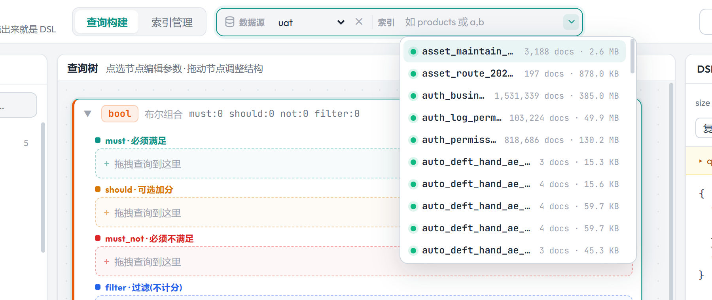

加载与执行都有明确的 loading 反馈：顶栏「运行」按钮图标变转圈、结果抽屉与状态栏同步显示「执行中」，顶栏改数据源/索引后查询树头部的「当前索引」徽标也会先显示「读取字段映射…」的过渡态再点亮。

这组控件和查询树头部的「当前索引」徽标是**联动**的：

- 顶栏选好数据源、填上索引名，会自动拉取该索引的字段映射——查询树头部亮起 `数据源 · 索引 · N 字段` 徽标，字段输入框随即获得联想候选；
- 反过来，在索引管理里点「用字段构建查询」，顶栏的数据源和索引也会同步成该索引；
- 点徽标主体直接跳到索引管理并定位到该索引；点徽标上的 `✕` 则解除联动，字段联想与顶栏索引一起清空。

- **表格**：`_id` / `_score` + `_source` 自动展平成列（嵌套对象变 `author.name`，数组原样 JSON），列名与值可悬停看全文；字段多时默认展示前 14 列，点页签行右侧的 **选择列**（带 `已选/总数` 计数）可勾选要看哪些列，带搜索过滤、全选与恢复默认——**偏好按索引记忆**
- **聚合**：有 `aggregations` 时展成「聚合 → 桶/值 → 文档数」，支持多级子聚合
- **请求体**：看清楚这一发到底发了什么（补齐默认 `size` / `track_total_hits` 后的最终 body）
- **原始响应**：未加工的完整 JSON，语法高亮
- 状态栏显示命中总数（含 `gte` 关系）、返回条数、最高分、`took` 与网络耗时、分片成功数
- 索引名支持 `a,b` 多索引与 `*` 通配
- 改动画布后状态栏会提示「DSL 已修改，结果可能过期」；可导出 CSV、复制响应 JSON
- 出错时按类型给建议：CORS 未开、查询超时、令牌缺失、ES 4xx 原因原样透出

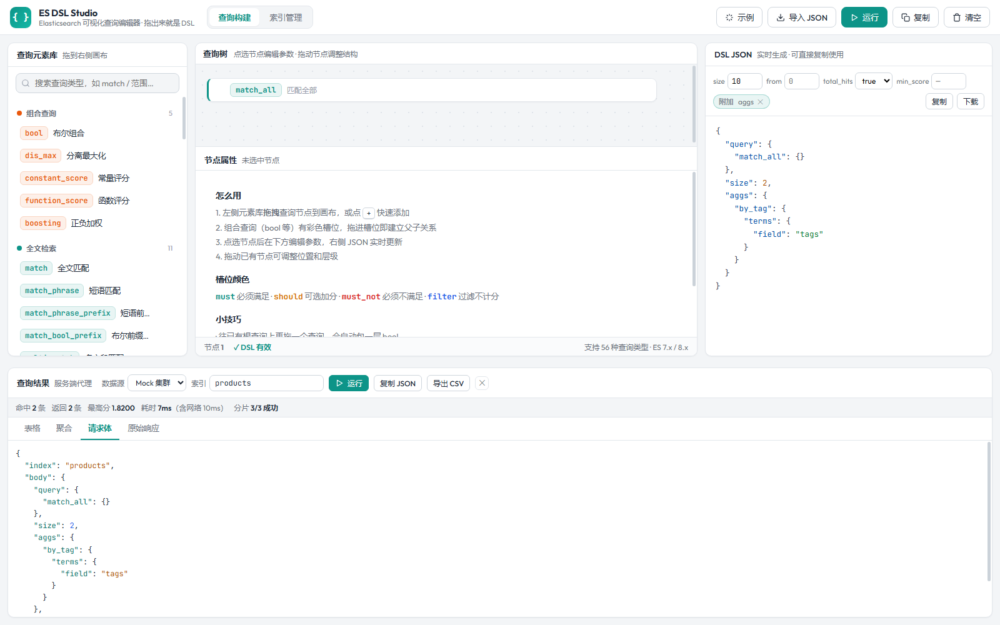

表格字段太多时，页签行右侧的「选择列」浮层可以勾选要展示的列（偏好按索引记忆）：

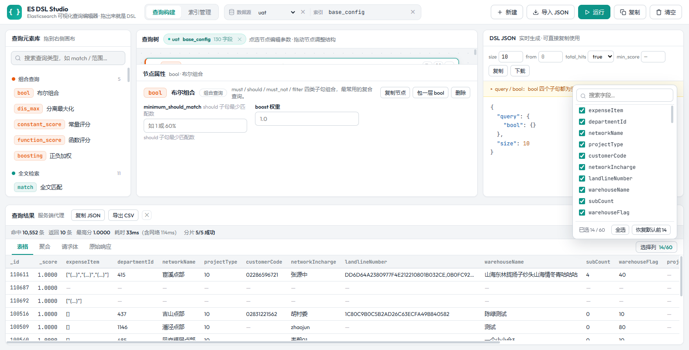

### DSL 反向导入

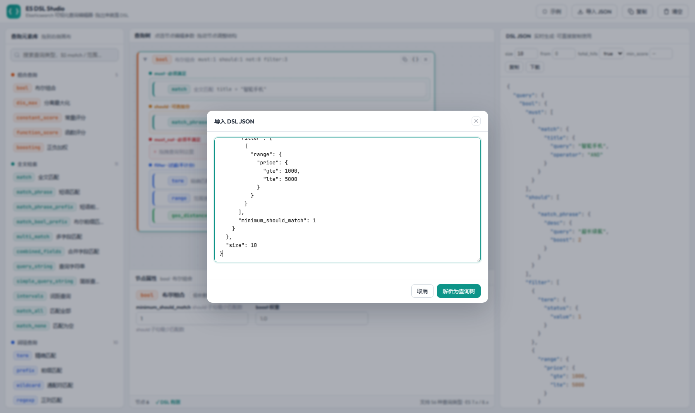

粘贴已有的 DSL（完整 search body 或 query 片段），自动解析回查询树继续编辑。
遇到编辑器尚未内置的新语法，自动降级为「自定义 JSON」节点原样保留，**不丢任何数据**。

顶层的 `aggs` / `sort` / `_source` / `highlight` 等非查询字段不会被丢弃：编辑器原样保留它们，并在 JSON 面板上以「附加」小标签标出（点 ✕ 可清除），执行查询时一并发送。

### 节点属性编辑

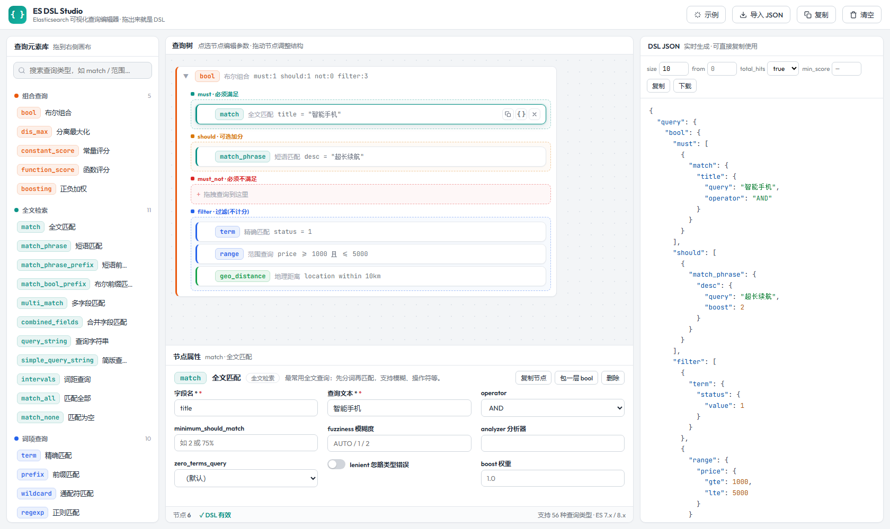

### 索引管理（多集群）

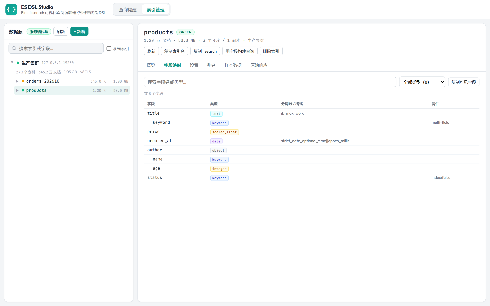

- **多数据源**：可配置多个 ES 集群，树形展开「数据源 → 索引 → 字段」，和 MyCat 的库表浏览手感一致
- **索引概览**：文档数、存储大小、主/副本分片、字段数、别名，一次看清
- **字段映射**：扁平化展示 `properties`，嵌套字段缩进、多字段（`title.keyword`）标注、`index: false` 与 `doc_values` 一目了然；支持按名称/类型搜索过滤
- **设置 / 别名 / 数据 / 原始响应**：其余四个页签分别看 `settings`（关键词高亮）、别名列表、Navicat 风格的数据表格、未加工的完整 mapping JSON
- **数据表格（Navicat 风格）**：`_id` + `_source` 列平铺展示，支持
  - **筛选**：字段 + 操作符（包含 / 等于 / 不等于 / 大于（等于）/ 小于（等于）/ 开头是 / 有值）组合条件，多条件可选 AND / OR，自动按字段类型生成 `term` / `range` / `wildcard` / `match_phrase` / `exists` 子句
  - **排序**：点列头循环 升序 → 降序 → 取消，走 ES `sort`
  - **分页**：每页 10 / 20 / 50 / 100 条，上一页 / 下一页
  - **增删改**：勾选行（可全选）后批量删除；双击行或点行尾铅笔图标编辑（按 mapping 生成的表单，对象字段走 JSON 编辑）；「+ 添加记录」可指定 `_id` 或留空自动生成；写操作后自动 `_refresh`，新记录立即可见
  - 数据源设为只读时自动隐藏写入入口
- **字段回填**：点「用字段构建查询」把当前索引的字段灌进查询编辑器；在顶栏选好数据源和索引也会自动带出字段
- **字段联想带类型**：`field` / `fields` / `path` 输入框聚焦即弹出自绘联想浮层，每条 = 字段名 + 彩色类型徽标（text / keyword / long / date …，与索引管理的字段映射同一套配色）；支持前缀与包含匹配（输入 `name` 也能联想 `author.name`）、↑↓ 选择、Enter 回填、悬停看完整字段名

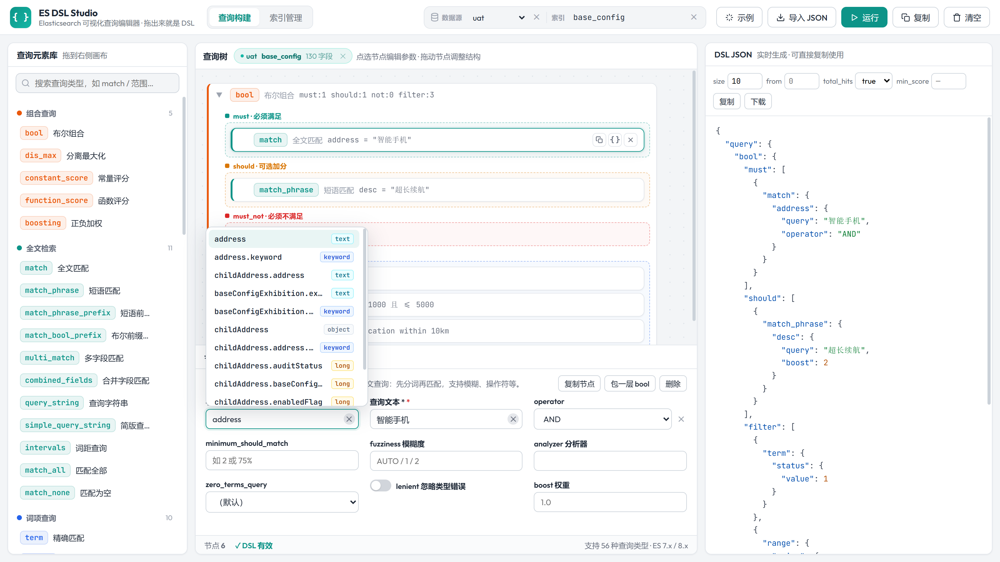
- **安全兜底**：删除索引必须手工输入索引名才可确认；数据源可设「只读模式」，服务端直接拒绝删索引 / 改字段 / 写文档等一切写操作
- 认证方式支持 `none` / `basic` / `ApiKey` / `Bearer`，也可关闭 TLS 证书校验以接入自签集群

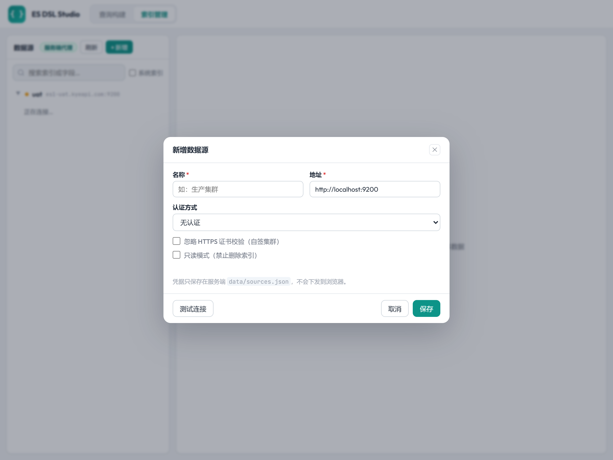

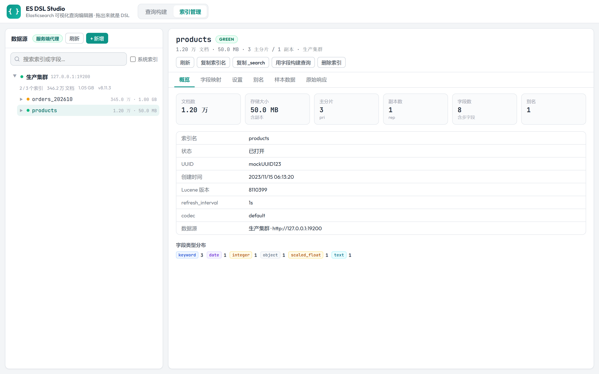

## 支持的查询类型（ES 7.x / 8.x）

| 分类 | 查询 |
|------|------|
| 组合查询 | bool、dis_max、constant_score、function_score、boosting |
| 全文检索 | match、match_phrase、match_phrase_prefix、match_bool_prefix、multi_match、combined_fields、query_string、simple_query_string、intervals、match_all、match_none |
| 词项查询 | term、terms、terms_set、range、exists、prefix、wildcard、regexp、fuzzy、ids |
| 地理位置 | geo_distance、geo_bounding_box、geo_polygon、geo_shape |
| 嵌套/父子 | nested、has_child、has_parent、parent_id |
| 向量检索 | knn（支持 filter 预过滤） |
| Span 查询 | span_term、span_multi、span_first、span_near、span_or、span_not、span_containing、span_within |
| 特殊查询 | script、script_score、more_like_this、percolate、rank_feature、distance_feature、pinned |
| 评分函数 | weight、random_score、script_score、field_value_factor、decay（gauss / linear / exp） |
| 自定义 | raw JSON（任意 DSL 片段原样嵌入） |

## 快速开始

### 桌面应用（Tauri，不需要 Python）

```bash
npm install          # 安装 Tauri CLI（仅开发/构建时需要）
npm run dev          # 开发模式：Rust 后端 + WebView2 窗口
npm run build        # 打包：src-tauri/target/release 下产出 exe / nsis / msi 安装包
```

桌面版把整个后端（静态托管 + ES 代理 + 数据源管理）编译进一个 exe，用户机器上**不需要 Python、不需要 Node**，只需 Windows 10/11 自带的 WebView2 运行时。前端通过自定义协议 `esdsl://` 与 Rust 通信，`fetch('/api/...')` 与浏览器版完全一致。数据源保存在 `%APPDATA%\com.esdsl.studio\sources.json`；首次启动会把旧版 `data/sources.json` 自动导入。

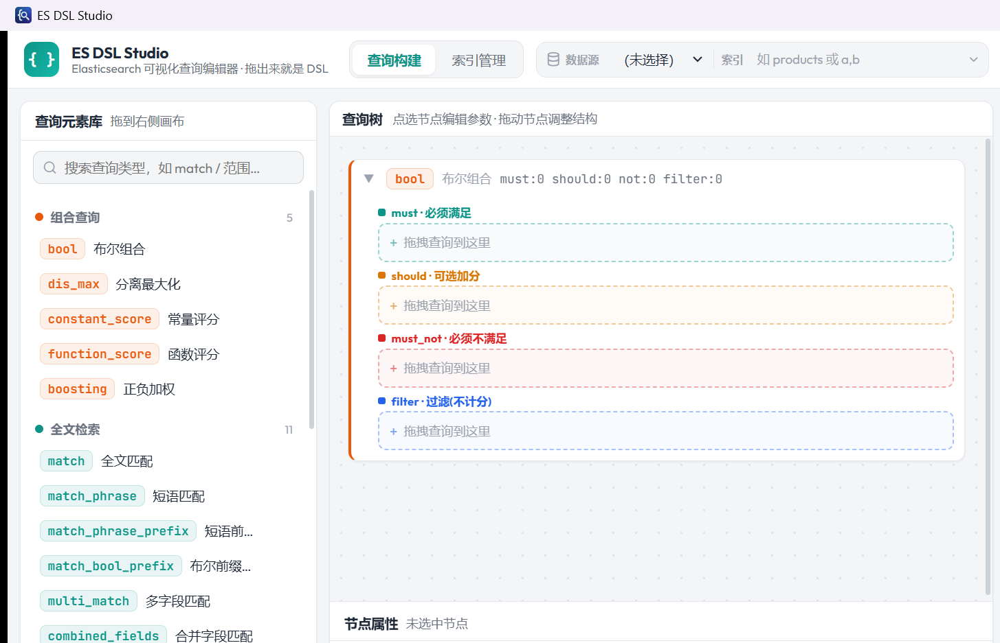

发布前可用自检模式验证 Rust 后端全链路（含真实 ES 访问，不弹窗口）：

```bash
src-tauri/target/debug/es-dsl-studio.exe --selftest
```

调试桥（启动窗口后执行一段 JS，结果经 `probe_result` 回传后退出）：

```bash
es-dsl-studio.exe --eval "setTimeout(() => __TAURI_INTERNALS__.invoke('probe_result', {payload: {mode: ESDC.getMode()}}), 4000)"
```

### 网页版（Python 后端）

只写查询、不需要连 ES：直接双击 `web/index.html` 就行。要用索引管理或「运行」查 ES，推荐起后端（直连模式要求 ES 开 CORS）：

```bash
python server.py
# 打开 http://127.0.0.1:8080
```

除了 Python 3.8+，没有任何依赖，不需要 `pip install`。

### 两种运行模式

索引管理视图会自动探测运行环境，右上角显示当前模式：

| 模式 | 怎么进入 | 请求走向 | 凭据存放 |
|------|----------|----------|----------|
| **桌面应用**（推荐） | `npm run dev` 或安装包启动 | WebView → Rust 内嵌代理 → ES | `%APPDATA%\com.esdsl.studio\sources.json`，不下发前端 |
| **服务端代理** | 通过 `python server.py` 访问 | 浏览器 → 本机 Python → ES | 服务端 `data/sources.json`，不下发浏览器 |
| **浏览器直连** | 直接双击 `web/index.html` | 浏览器 → ES | 本机 localStorage，需要 ES 开 CORS |

直连模式适合临时用一下；正式使用请走服务端代理，既绕开 CORS，也不把密码摊在浏览器里。

## 配置

全部通过环境变量，都有默认值：

| 变量 | 默认 | 说明 |
|------|------|------|
| `PORT` | `8080` | 监听端口；**设置该变量时会绑定 `0.0.0.0`**，否则只绑 `127.0.0.1` |
| `ESDSL_TOKEN` | 空 | 设置后所有 `/api/*` 需要令牌，见下方「对外暴露」 |
| `ESDSL_ES_TIMEOUT` | `15` | 单次 ES 请求超时（秒） |

```bash
PORT=8080 ESDSL_TOKEN=my-secret python server.py
```

### 对外暴露（给同事试用）

`data/sources.json` 里是**明文密码 / API Key**，所以默认只听 `127.0.0.1`。要让别人访问时务必：

1. 设置 `ESDSL_TOKEN`，否则同网段任何人都能通过本服务读写你的 ES；
2. 放在反向代理之后并加 HTTPS；
3. 只读场景给数据源勾上「只读模式」；
4. 不要把 `data/` 提交到版本库（`.gitignore` 已包含）。

前端会在收到 401 时弹出令牌输入框，令牌存在浏览器 localStorage，通过 `X-ESDSL-Token` 头带上。

## HTTP 接口

除 `/api/health` 外均需令牌（若已配置）。密钥字段（`password` / `apiKey` / `token`）不会出现在任何响应里，只返回 `hasSecret: true`。

| 方法与路径 | 说明 |
|------------|------|
| `GET /api/health` | 健康检查，返回 `{ok, authRequired, version}` |
| `POST /api/test` | 用表单里的连接参数试连（不落库） |
| `GET /api/sources` | 数据源列表（脱敏） |
| `POST /api/sources` | 新增或更新数据源；密文字段留空表示沿用原值 |
| `DELETE /api/sources/{id}` | 删除数据源 |
| `POST /api/sources/{id}/test` | 用已保存的配置试连 |
| `GET /api/sources/{id}/indices` | 索引列表（`_cat/indices`，带 `_alias` 降级） |
| `GET /api/sources/{id}/indices/{index}/detail` | mapping + settings + alias |
| `GET /api/sources/{id}/indices/{index}/sample?size=10` | 抽样文档 |
| `POST /api/sources/{id}/search` | 执行任意查询体：`{"index":"a,b","body":{...}}`，原样转发到 `POST /{index}/_search` |
| `DELETE /api/sources/{id}/indices/{index}` | 删除索引（只读数据源返回 403） |

## 项目结构

```
es-dsl-editor/
├── web/                      # 纯前端（零构建，桌面版 frontendDist 指向它）
│   ├── index.html            # 页面骨架（查询构建 / 索引管理两个视图）
│   ├── css/
│   │   └── styles.css        # 全部样式（浅色主题）
│   └── js/
│       ├── queries.js        # 核心：56 种查询类型定义 + 树↔DSL 双向转换 + 校验（纯逻辑，无 DOM）
│       ├── app.js            # UI：元素库 / 拖拽 / 查询树 / 属性面板 / JSON 预览 / 执行结果抽屉
│       ├── es-client.js      # ES 通信层：服务端代理 / 浏览器直连双模式 + mapping 扁平化等纯函数
│       ├── col-picker.js     # 「选择列」浮层（偏好按索引记忆）
│       └── index-browser.js  # 索引管理视图：数据源树 / 索引树 / 详情页签 / 删除确认
├── src-tauri/                # 桌面版：Rust 后端（Tauri v2，无 Python 依赖）
│   ├── src/
│   │   ├── lib.rs            # 入口：注册 esdsl:// 协议 + 启动
│   │   ├── proto.rs          # 自定义协议：/api/* → API，其余 → 前端静态资源
│   │   ├── api.rs            # /api 路由（与 server.py 对齐）
│   │   ├── es.rs             # ES 代理（reqwest + Windows SChannel TLS）
│   │   └── store.rs          # 数据源 CRUD + sources.json 原子持久化
│   ├── tauri.conf.json       # 窗口 / 打包 / 协议配置
│   └── icons/                # 应用图标
├── server.py                 # Python 标准库后端（网页版用）：静态文件 + ES 反向代理 + 数据源管理
├── data/                     # 运行时生成：sources.json（明文凭据，勿提交）
├── test/
│   ├── core.test.js          # 核心逻辑回归（24 项：生成 + 导入往返 + 校验）
│   └── datasource.test.js    # 通信层与结果整形回归（78 项：mapping 扁平化、认证头、文档展平、聚合拍平…）
├── docs/                     # README 截图
├── package.json              # 仅开发用：Tauri CLI + scripts（dev / build）
└── README.md
```

## 开发与测试

核心逻辑、通信层都刻意做成「无 DOM 的纯函数」，可在 Node 里直接跑：

```bash
node test/core.test.js
node test/datasource.test.js
python -m py_compile server.py
```

### 新增一种查询类型

只需在 `js/queries.js` 中追加一个定义（字段表单、DSL 生成、JSON 反向解析），UI 会自动出现在元素库中：

```js
def({
  type: 'my_query', cat: 'termq', cn: '我的查询', valueKey: 'value',
  desc: '一句话说明。',
  fields: [
    { k: 'field', label: '字段名 *', kind: 'text', req: true },
    { k: 'value', label: '值 *', kind: 'text', req: true },
  ],
  build: fqBuild,        // 标准 {type: {field: {...}}} 结构可直接复用
  fromJson: fqFrom,
});
```

### 新增一种数据源认证方式

在 `js/es-client.js` 的 `AUTH_TYPES` / `authHeaders()` 与后端各加一段即可，两边保持一致：Python 版改 `server.py` 的 `es_request()`，桌面版改 `src-tauri/src/es.rs` 的 `es_request()`。

## 浏览器兼容

Chrome / Edge / Firefox 最新版本（依赖 `color-mix()`、ES2020+）。

## License

MIT
